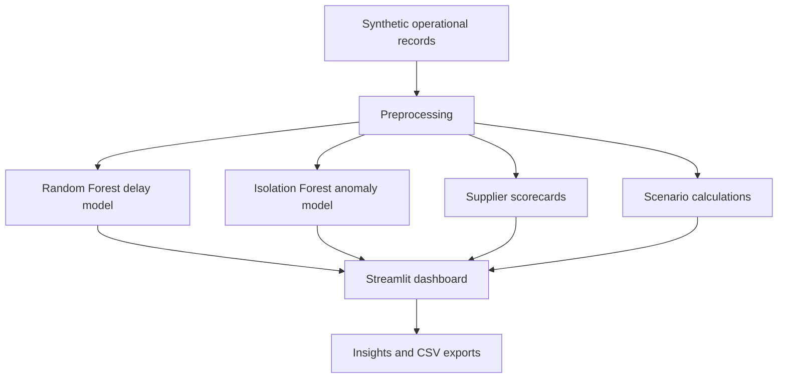

# SupplyChainIQ AI
### Enterprise Supply Chain Intelligence, Risk Analytics & Inventory Optimization

**See risk earlier. Balance inventory smarter. Build resilient operations.**

SupplyChainIQ AI is an interactive supply-chain analytics demonstrator combining operational visibility, supplier scorecards, inventory risk analysis, anomaly discovery and predictive delivery-delay modelling in one Streamlit dashboard.

> **Data notice:** The application generates synthetic operational data. It is not connected to real suppliers, shipments, ERP or warehouse systems.

## Workspaces
| Workspace | Capability |
|---|---|
| Executive Overview | KPIs, regional delay performance and inventory health |
| Demand & Inventory | Demand-versus-stock analysis and replenishment watchlist |
| Supplier Intelligence | Reliability, quality, lead-time and composite scorecards |
| Risk & Anomalies | Supplier risk bands and Isolation Forest anomaly discovery |
| Scenario Planner | Interactive demand, inventory and lead-time sensitivity |
| Data Explorer | Filter, inspect and export records |
| Model Performance | Held-out regression metrics and prediction comparison |
| Governance | Data provenance, model scope and limitations |

## Machine learning
**Delivery delay prediction:** Random Forest regression using demand, inventory, lead time, cost, supplier reliability, quality, disruption, supplier, region and category. Numeric features are standardized and categorical features one-hot encoded. A 75/25 train-test split reports MAE, RMSE and R².

```python
RandomForestRegressor(
    n_estimators=180,
    max_depth=12,
    min_samples_leaf=2,
    random_state=42
)
```

**Anomaly discovery:** Isolation Forest highlights unusual combinations of selected operational features.

```python
IsolationForest(contamination=0.06, n_estimators=160, random_state=42)
```

Anomaly flags are investigation signals, not proof of supplier misconduct or operational failure. Supplier performance scoring and scenario calculations are transparent project heuristics, not certified industry methods.

## Architecture


## Technology
Python · Streamlit · Pandas · NumPy · Scikit-learn · Plotly

The dashboard uses a premium Aurora Sapphire visual system with deep navy surfaces, cyan highlights, sapphire accents and champagne details.

## Run locally
```bash
git clone https://github.com/YOUR_USERNAME/SupplyChainIQ-AI.git
cd SupplyChainIQ-AI
python -m venv venv
# Windows: venv\Scripts\activate
# macOS/Linux: source venv/bin/activate
pip install -r requirements.txt
streamlit run app.py
```

## Deploy on Render
The included `render.yaml` provides:
- Build: `pip install -r requirements.txt`
- Start: `streamlit run app.py --server.port $PORT --server.address 0.0.0.0`

## Project structure
```text
SupplyChainIQ-AI/
├── .streamlit/config.toml
├── app.py
├── requirements.txt
├── render.yaml
├── README.md
├── LICENSE
├── .gitignore
└── data/sample_supply_chain_data.csv
```

## Responsible use and limitations
- Data is generated locally and is not real company or supplier information.
- No live shipment tracking, ERP/WMS integration, external risk feeds or IoT telemetry.
- No purchase orders or supplier decisions are automated.
- Synthetic-data model metrics do not establish real-world predictive performance.
- Scenario outputs are simplified sensitivity estimates, not an optimization engine.
- Real use requires validated enterprise data, monitoring, security, governance and human oversight.

## Future roadmap
ERP/WMS connectors · Time-series demand forecasting · Multi-echelon inventory optimization · Supplier lead-time uncertainty · SHAP explainability · Role-based access and audit trails.

## Author
**Mohamed Riyaz S.**  
Integrated M.Tech, Computer Science and Engineering  
Specialization in Business Analytics · VIT Chennai

MIT License.
