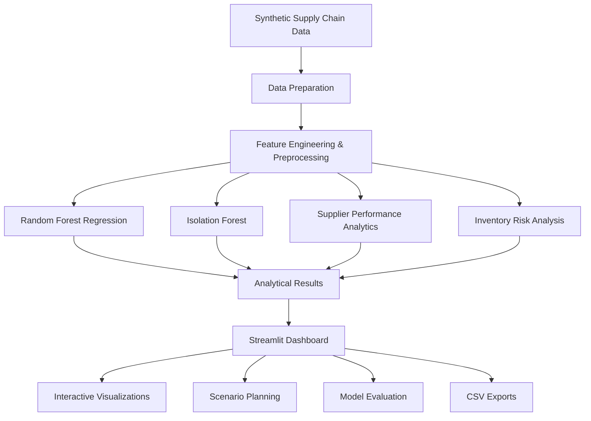

# SupplyChainIQ AI
### Intelligent Supply Chain Analytics & Predictive Intelligence Platform

---

## Overview

**SupplyChainIQ AI** is an interactive supply chain intelligence platform designed to demonstrate how machine learning and advanced analytics can improve operational visibility, supplier evaluation, inventory planning and risk assessment. The platform integrates predictive delivery-delay modelling, supplier performance analytics, inventory health monitoring, anomaly detection and interactive scenario planning into a unified enterprise-style dashboard.

Built with Python, Streamlit, Scikit-learn, Pandas, NumPy and Plotly, it transforms simulated operational data into meaningful analytical insights through an intuitive, premium dashboard experience.

> **Live Demo:** https://supplychainiq-ai.onrender.com/ 

> **Data Transparency:** This project uses synthetically generated operational data. It is an interactive portfolio demonstrator, not a live enterprise supply chain integration.

## Project Highlights

| Capability | Implementation |
|---|---|
| Predictive Analytics | Random Forest delivery-delay regression |
| Anomaly Detection | Isolation Forest |
| Supplier Intelligence | Reliability, quality and risk scorecards |
| Inventory Analytics | Demand-versus-stock analysis |
| Risk Assessment | Supplier risk bands and anomaly flags |
| Scenario Planning | Interactive what-if analysis |
| Model Evaluation | MAE, RMSE and R² |
| Data Visualization | Interactive Plotly charts |
| Dashboard | Multi-workspace Streamlit application |

## Dashboard Workspaces

The platform is organized into eight analytical workspaces.

### 01. Executive Overview
A centralized operational command centre featuring:
- Average delivery-delay indicators
- Inventory risk percentage
- Operational anomaly rate
- Supplier risk index
- Regional delivery performance
- Inventory health distribution
- Key operational priority signals

### 02. Demand & Inventory
Explore inventory availability and demand patterns through:
- Demand-versus-inventory analysis
- Category-level demand and stock comparisons
- Inventory health classification
- Inventory gap calculations
- Replenishment priority watchlist
- CSV export functionality

### 03. Supplier Intelligence
Evaluate supplier performance using:
- On-time delivery rates
- Product quality rates
- Average supplier lead times
- Delivery-delay analysis
- Supplier risk scores
- Composite supplier performance scoring

### 04. Risk & Anomalies
Identify unusual operational patterns using:
- Isolation Forest anomaly detection
- Supplier risk classification
- High-risk and critical-risk record identification
- Lead-time and procurement-cost analysis
- Anomaly inspection and record exports

### 05. Scenario Planner
Explore hypothetical operational changes using interactive controls for:
- Demand variation
- Inventory uplift
- Supplier lead-time changes
- Projected inventory coverage
- Estimated lead-time changes
- Illustrative operational risk index

### 06. Data Explorer
Provides an interactive environment for:
- Inspecting operational records
- Exploring supplier and regional information
- Reviewing inventory and delivery attributes
- Filtering the dataset
- Exporting filtered records as CSV

### 07. Model Performance
Evaluate the delivery-delay prediction model through:
- Mean Absolute Error (MAE)
- Root Mean Squared Error (RMSE)
- R² score
- Actual-versus-predicted comparison
- Held-out model evaluation

### 08. Governance
Documents:
- Synthetic data provenance
- Model methodology
- Responsible AI considerations
- System limitations
- Human oversight requirements
- Future development opportunities

---

## Machine Learning & Analytics

### 1. Delivery Delay Prediction — Random Forest Regressor

The predictive modelling component estimates delivery delays using operational and supplier-related attributes.

**Input features:**

| Feature | Description |
|---|---|
| demand_units | Product demand volume |
| inventory_units | Available inventory |
| lead_time_days | Supplier lead time |
| unit_cost | Procurement unit cost |
| on_time_rate | Supplier delivery reliability |
| quality_rate | Product quality performance |
| disruption_flag | Simulated disruption indicator |
| supplier | Supplier identifier |
| region | Operational region |
| category | Product category |

**Preprocessing:**
- StandardScaler for numerical features.
- OneHotEncoder for categorical features.
- ColumnTransformer for combined preprocessing.
- 75% training and 25% testing split.

**Model configuration:**

```python
RandomForestRegressor(
    n_estimators=180,
    max_depth=12,
    min_samples_leaf=2,
    random_state=42,
    n_jobs=-1
)
```

**Evaluation metrics:**
- Mean Absolute Error (MAE)
- Root Mean Squared Error (RMSE)
- Coefficient of Determination (R²)

### 2. Operational Anomaly Detection — Isolation Forest

Isolation Forest identifies unusual combinations of operational characteristics that may require further investigation.

**Configuration:**

```python
IsolationForest(
    contamination=0.06,
    n_estimators=160,
    random_state=42
)
```

The model examines numerical operational features, including demand, inventory, lead time, cost, supplier reliability, quality and disruption indicators.

Anomaly flags are analytical review signals, not definitive evidence of supplier misconduct or operational failure.

### 3. Supplier Performance Intelligence

A composite supplier performance score is calculated using an illustrative weighted approach:

- On-time delivery: 40%
- Quality performance: 35%
- Inverse supplier risk: 25%

The resulting score supports comparative supplier analysis within the demonstrator. It is not a certified industry-standard rating.

### 4. Inventory Risk Classification

Inventory records are categorized using demand coverage thresholds:

| Classification | Condition |
|---|---|
| Healthy | Inventory at or above demand |
| Watch | Inventory below demand |
| At Risk | Inventory below 55% of demand |

These categories are project-defined indicators for inventory monitoring.

---

## System Architecture

The application follows a structured analytical workflow.



## Data Workflow

1. Generate synthetic supply chain operational records.
2. Prepare numerical and categorical attributes.
3. Preprocess features for machine learning.
4. Train the Random Forest regression model.
5. Evaluate delivery-delay predictions on held-out data.
6. Apply Isolation Forest for anomaly identification.
7. Calculate supplier performance and inventory indicators.
8. Present insights through interactive dashboard workspaces.
9. Enable filtering, scenario exploration and CSV exports.

---

## Technology Stack

| Category | Technologies |
|---|---|
| Programming Language | Python |
| Dashboard Framework | Streamlit |
| Data Manipulation | Pandas, NumPy |
| Machine Learning | Scikit-learn |
| Predictive Modelling | Random Forest Regressor |
| Anomaly Detection | Isolation Forest |
| Data Preprocessing | StandardScaler, OneHotEncoder |
| Visualization | Plotly |
| Deployment | Render |
| Version Control | Git, GitHub |

## Application Design

SupplyChainIQ AI uses a premium **Aurora Sapphire** visual identity.

**Design elements:**
- Deep navy dashboard surfaces
- Sapphire blue and cyan highlights
- Champagne accent details
- Refined typography and spacing
- Interactive navigation
- Structured KPI cards
- Consistent chart and table styling

The interface is designed to resemble a modern enterprise analytics application.

---

## Project Structure

```text
SupplyChainIQ-AI/
│
├── .streamlit/
│   └── config.toml
│
├── assets/
│   ├── supplychainiq_logo.png
│   └── supplychainiq_favicon.png
│
├── data/
│   └── sample_supply_chain_data.csv
│
├── app.py
├── requirements.txt
├── render.yaml
├── README.md
├── LICENSE
└── .gitignore
```

*The `assets/` directory contains the dashboard logo and favicon when you add them to your local project.*

## Installation & Local Setup

### Prerequisites

- Python 3.10 or later
- Git
- Visual Studio Code (recommended)

### Step 1 — Clone the repository

```bash
git clone https://github.com/YOUR_USERNAME/SupplyChainIQ-AI.git
```

### Step 2 — Navigate into the project

```bash
cd SupplyChainIQ-AI
```

### Step 3 — Create a virtual environment

```bash
python -m venv venv
```

**Windows:**

```bash
venv\Scripts\activate
```

**macOS / Linux:**

```bash
source venv/bin/activate
```

### Step 4 — Install dependencies

```bash
pip install -r requirements.txt
```

### Step 5 — Launch the application

```bash
streamlit run app.py
```

Open the local dashboard:

```text
http://localhost:8501
```

---

## Deployment — Render

The application includes a `render.yaml` configuration for deployment.

**Build Command:**

```bash
pip install -r requirements.txt
```

**Start Command:**

```bash
streamlit run app.py --server.port $PORT --server.address 0.0.0.0
```

**Deployment workflow:**

1. Push the project to GitHub.
2. Connect the repository to Render.
3. Create a Python web service or deploy using the Blueprint configuration.
4. Configure the build and start commands if required.
5. Deploy the application.
6. Open the generated public URL.

---

## Business Applications

The analytical concepts demonstrated in SupplyChainIQ AI are relevant to:

- Supply chain performance monitoring
- Procurement analytics
- Supplier reliability assessment
- Inventory health monitoring
- Delivery-delay analysis
- Operational anomaly investigation
- Risk-aware inventory planning
- Data-driven business decision support

## Responsible Use & Limitations

SupplyChainIQ AI is developed as an educational and portfolio demonstration.

**Current limitations:**

- Operational records are synthetically generated.
- No live ERP, WMS or procurement integration.
- No real-time shipment or carrier tracking.
- No external supplier-risk or threat intelligence feeds.
- No IoT or live logistics telemetry.
- No automated purchase orders or supplier decisions.
- Scenario calculations are simplified sensitivity estimates, not an optimization solver.
- Model metrics reflect synthetic data and do not establish real-world predictive performance.

For real operational use, the system would require validated enterprise datasets, domain-specific testing, model monitoring, security controls, governance and human oversight.

---

## Future Enhancements

Potential development directions include:

- Time-series demand forecasting.
- Multi-echelon inventory optimization.
- ERP and Warehouse Management System integrations.
- Live shipment and carrier tracking.
- Supplier lead-time uncertainty modelling.
- SHAP-based model explainability.
- Advanced procurement optimization.
- Role-based access control.
- Audit trails and model monitoring.

---

## Author

**Mohamed Riyaz S.**  
Integrated M.Tech – Computer Science and Engineering (Business Analytics)  
Vellore Institute of Technology (VIT), Chennai

**Technical Interests:** Machine Learning · Predictive Analytics · Business Intelligence · Data Science · AI-Powered Decision Systems

---

## License

This project is licensed under the MIT License. See the [LICENSE](LICENSE) file for details.

---

<p align="center">
  <strong>SupplyChainIQ AI</strong><br>
  Intelligent Insights. Smarter Operations. Stronger Supply Chains.
</p>

<p align="center">
  Developed by Mohamed Riyaz S. | 2026
</p>
